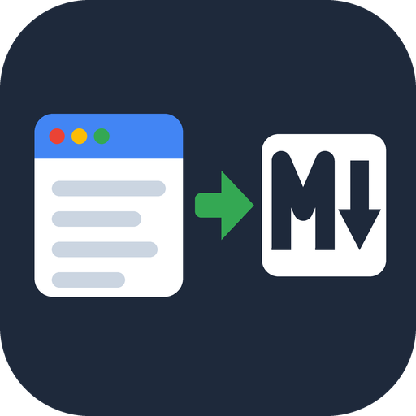

<p align="center"></p>

# URL to Markdown for LLMs (remote MCP tool)

Turn web pages and PDFs into clean, LLM-ready Markdown with metadata, token counts and optional RAG chunks. Works as a remote MCP tool and through the Apify API.

It runs as an [Apify Actor](https://apify.com/cleandata-labs/url-to-markdown) maintained by CleanData Labs, so you can use it in two ways:

1. **As a tool for your AI agent** (Claude, Cursor, VS Code / Copilot, Claude Code or any MCP client) through the hosted Apify MCP server. Nothing to install.
2. **From your own code** with the official `apify-client` for Python or JavaScript.

This repository holds the docs, ready-to-paste MCP configs and small runnable examples. The Actor itself is hosted on Apify; there is no server code to run here.

```text
https://mcp.apify.com?tools=cleandata-labs/url-to-markdown
```

## What it does

- **Main-content extraction** (no menus, cookie banners or footers) or the full page, fine-tuned with CSS selectors to keep or remove elements.
- **Markdown, plain text or cleaned HTML**, with title, author, publish date, language, description and canonical URL.
- **PDF to Markdown/text** (first N pages) at the same price as a web page.
- **Small crawls**: follow links up to a depth or start from the sitemap, with include/exclude URL globs and a per-site page limit. Duplicates are skipped and not charged.
- **RAG chunks**: split on paragraph boundaries with a token size and overlap; every row has `approxTokens`.
- **JavaScript pages**: plain HTTP first, a headless browser only when the page needs it.
- **Polite by default**: respects robots.txt and sends an identifiable User-Agent.

## Connect it to your AI agent (MCP)

The URL above is a Streamable HTTP MCP endpoint that exposes one tool, `cleandata-labs--url-to-markdown`, whose arguments are the [input fields](docs/input-reference.md). Two ways to authorize:

- **OAuth (recommended):** add only the URL. On first use your client opens an Apify sign-in page. A free Apify account works.
- **API token:** send the header `Authorization: Bearer <YOUR_APIFY_TOKEN>`. Get the token in [Apify Console > Settings > API & Integrations](https://console.apify.com/settings/integrations). Keep it out of git.

Ready-made config files are in [`examples/mcp/`](examples/mcp/).

### Claude (claude.ai and Claude Desktop)

Settings > Connectors > **Add custom connector**. Name: `URL to Markdown`, Remote MCP server URL: `https://mcp.apify.com?tools=cleandata-labs/url-to-markdown`. Sign in with Apify when asked.

If you prefer a local config file, Claude Desktop can run Apify's official stdio server instead (`claude_desktop_config.json`, needs Node.js 18+):

```json
{
  "mcpServers": {
    "url-to-markdown": {
      "command": "npx",
      "args": ["-y", "@apify/actors-mcp-server", "--tools", "cleandata-labs/url-to-markdown"],
      "env": { "APIFY_TOKEN": "<YOUR_APIFY_TOKEN>" }
    }
  }
}
```

### Cursor

`~/.cursor/mcp.json` (global) or `.cursor/mcp.json` (project). OAuth:

```json
{
  "mcpServers": {
    "url-to-markdown": {
      "url": "https://mcp.apify.com?tools=cleandata-labs/url-to-markdown"
    }
  }
}
```

With a token instead:

```json
{
  "mcpServers": {
    "url-to-markdown": {
      "url": "https://mcp.apify.com?tools=cleandata-labs/url-to-markdown",
      "headers": { "Authorization": "Bearer <YOUR_APIFY_TOKEN>" }
    }
  }
}
```

### VS Code (GitHub Copilot agent mode)

`.vscode/mcp.json`. OAuth:

```json
{
  "servers": {
    "url-to-markdown": {
      "type": "http",
      "url": "https://mcp.apify.com?tools=cleandata-labs/url-to-markdown"
    }
  }
}
```

With a token, VS Code can prompt for it once and store it securely:

```json
{
  "inputs": [
    { "type": "promptString", "id": "apify-token", "description": "Apify API token", "password": true }
  ],
  "servers": {
    "url-to-markdown": {
      "type": "http",
      "url": "https://mcp.apify.com?tools=cleandata-labs/url-to-markdown",
      "headers": { "Authorization": "Bearer ${input:apify-token}" }
    }
  }
}
```

### Claude Code

```bash
claude mcp add --transport http url-to-markdown "https://mcp.apify.com?tools=cleandata-labs/url-to-markdown"
# or with a token:
claude mcp add --transport http url-to-markdown "https://mcp.apify.com?tools=cleandata-labs/url-to-markdown" --header "Authorization: Bearer $APIFY_TOKEN"
```

### Other clients and combining tools

Any client that supports remote Streamable HTTP servers can use the same URL. To load several Actors in one connection, separate them with commas, e.g. `https://mcp.apify.com?tools=cleandata-labs/google-trends-explorer,cleandata-labs/url-to-markdown`. Already using `https://mcp.apify.com` with the default tools? Ask your agent to run `cleandata-labs/url-to-markdown`.

### Try these prompts

- "Read https://docs.apify.com/platform/actors as Markdown and summarize it in 5 bullet points."
- "Convert up to 10 pages under https://crawlee.dev/python/docs/ into Markdown chunks of about 800 tokens and list the page titles."
- "Extract the first 5 pages of https://arxiv.org/pdf/1706.03762 and list the key contributions."

### Tips for agents

- Smallest useful input: `{"urls": ["https://docs.apify.com/platform/actors"], "maxCharacters": 20000}` (one page, cut to about 5k tokens).
- Always pass your own `urls`; the default list is only a demo.
- For a docs section use `maxCrawlDepth: 1` or `useSitemap: true` with `maxPagesPerStartUrl` (e.g. 10) and `includeUrlGlobs`.
- Set `includeLinks: false` to save tokens when links are not needed.
- A single page takes 2-5 seconds; small crawls (10-20 pages) usually finish in under a minute.

## Use it from code

Python (`pip install apify-client`):

```python
import os
from apify_client import ApifyClient

client = ApifyClient(os.environ["APIFY_TOKEN"])
run = client.actor("cleandata-labs/url-to-markdown").call(run_input={"urls": ["https://docs.apify.com/platform/actors"], "maxCharacters": 20000})
for item in client.dataset(run.default_dataset_id).iterate_items():
    print(item)
```

JavaScript / Node.js (`npm install apify-client`):

```js
import { ApifyClient } from 'apify-client';

const client = new ApifyClient({ token: process.env.APIFY_TOKEN });
const run = await client.actor('cleandata-labs/url-to-markdown').call({"urls": ["https://docs.apify.com/platform/actors"], "maxCharacters": 20000});
const { items } = await client.dataset(run.defaultDatasetId).listItems();
console.log(items);
```

Runnable examples, each with a hard cost cap (`max_total_charge_usd` / `maxTotalChargeUsd`):

- Python: [`page_to_markdown.py`](examples/python/page_to_markdown.py), [`docs_to_rag_chunks.py`](examples/python/docs_to_rag_chunks.py), [`pdf_to_text.py`](examples/python/pdf_to_text.py). See [`examples/python/README.md`](examples/python/README.md).
- Node.js: [`page-to-markdown.mjs`](examples/node/page-to-markdown.mjs), [`rag-chunks.mjs`](examples/node/rag-chunks.mjs). See [`examples/node/README.md`](examples/node/README.md).

```bash
export APIFY_TOKEN=...            # never commit it
cd examples/python && pip install -r requirements.txt && python page_to_markdown.py
cd examples/node && npm install && node page-to-markdown.mjs
```

You can also call it over plain HTTP, from Make, Zapier or n8n, or on a schedule. See the [Apify API docs](https://docs.apify.com/api/v2).

## Input and output

Full list of input fields with types and defaults: [`docs/input-reference.md`](docs/input-reference.md).

Example output row:

```json
{
  "url": "https://react.dev/learn",
  "finalUrl": "https://react.dev/learn",
  "statusCode": 200,
  "title": "Quick Start – React",
  "language": "en",
  "publishedAt": null,
  "markdown": "## Quick Start\n\nWelcome to the React documentation! ...",
  "characters": 18342,
  "words": 2711,
  "approxTokens": 4585,
  "fetchedWith": "http",
  "crawlDepth": null,
  "chunks": [
    {
      "index": 0,
      "text": "## Quick Start ...",
      "approxTokens": 790
    }
  ]
}
```

`fetchedWith` is `http`, `browser` or `pdf`. With `includeLinkList` you also get `links.internal` / `links.external`. Failed URLs come back as rows with `error` (and `blocked: true` for bot walls) and are not charged.

## Pricing

Pay per event on Apify: **$0.002 per converted page** ($2 per 1,000 pages). You pay Apify from your own Apify account; nothing is billed through this repository.

- Web pages and PDFs cost the same.
- Failed, blocked (401/403/429, bot walls), robots.txt-disallowed and duplicate URLs are free.
- Apify adds its standard Actor start event ($0.00005 per run, per GB of memory). There is no separate compute fee.
- For crawls, set a *maximum cost per run* (smallest allowed: $0.10); the run stops cleanly when it is reached.

Apify's free plan includes a monthly platform credit (currently $5), which is enough to try the tool on real data. Prices can change; the [Actor page](https://apify.com/cleandata-labs/url-to-markdown) always shows the current price.

## Good to know

- This is an independent tool by CleanData Labs. It is not affiliated with or endorsed by Google. It reads publicly available pages; use the data in line with the source site's terms and the laws that apply to you.
- The examples call the live Actor, so each run costs a little (see the cost note at the top of each script).
- Found a bug or need a field? Open an issue here or on the Actor's Issues tab on Apify.

## Links

- Apify Actor: <https://apify.com/cleandata-labs/url-to-markdown>
- MCP endpoint: `https://mcp.apify.com?tools=cleandata-labs/url-to-markdown`
- MCP registry name: `io.github.CleanData-Labs/url-to-markdown` (see [`server.json`](server.json))
- Tutorial: [How to convert web pages and PDFs to clean Markdown for LLMs and RAG (2026)](https://dev.to/cleandatalab/how-to-convert-web-pages-and-pdfs-to-clean-markdown-for-llms-and-rag-2026-5c2i)
- Apify MCP server docs: <https://docs.apify.com/platform/integrations/mcp>

More tools from CleanData Labs:

- [Google Trends Explorer](https://github.com/CleanData-Labs/google-trends-explorer-mcp): Google Trends data for AI agents and scripts: interest over time, interest by region, related and rising queries, Trending Now and keyword suggestions.
- [Google Ads Transparency Explorer](https://github.com/CleanData-Labs/google-ads-transparency-explorer-mcp): See the ads any company runs on Google Search, YouTube, Shopping, Maps and Play, from the public Google Ads Transparency Center.

## License

The example code and docs in this repository are released under the [MIT License](LICENSE). The hosted Actor is a paid service under [Apify's terms](https://apify.com/store-terms-and-conditions).
